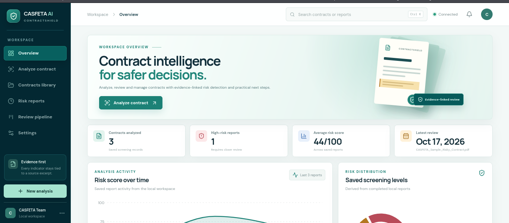
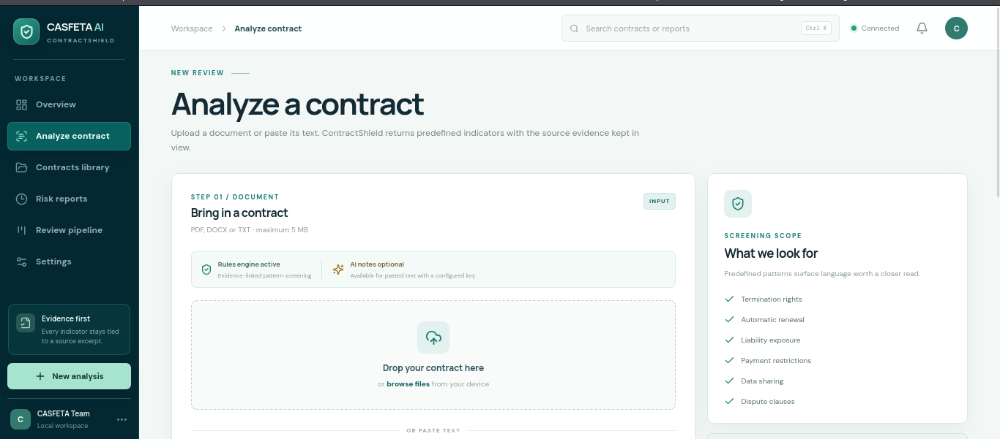
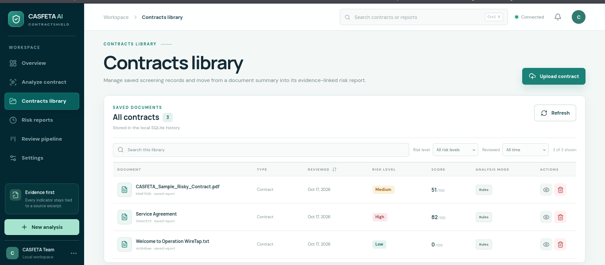
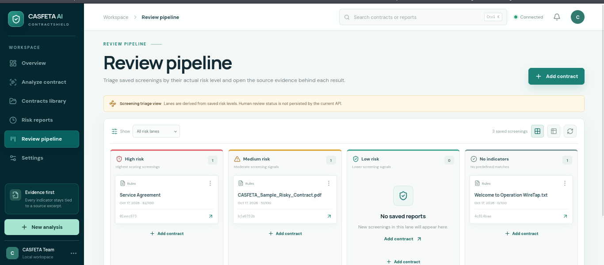

<!-- CASFETA SCREENSHOTS START -->
# CASFETA AI — ContractShield

**Intelligent Contract Risk Analysis Platform**

## Application Screenshots

### Dashboard


### Contract Analysis


### Risk Report


### Review Pipeline


<!-- CASFETA SCREENSHOTS END -->

---

# CASFETA ContractShield AI

CASFETA ContractShield AI is an evidence-backed contract screening workspace for teams that need a faster first pass over commercial agreements. It combines a transparent rules engine, optional AI explanations, clause-level evidence, saved risk reports and PDF export in a document-centric LegalTech interface.

The project is an educational prototype and a review aid. It does not provide legal advice, replace counsel or make autonomous legal decisions.

## Product capabilities

- Analyze pasted contract text or upload PDF, DOCX and TXT files.
- Detect predefined risk indicators and show the matched clause, excerpt offsets, severity, explanation and suggested next step.
- Review saved reports from the dashboard, Contracts Library, Risk Reports and Review Pipeline views.
- Search, filter and sort saved reports using data returned by the FastAPI service.
- Open an evidence-linked report workspace with a scrollable document viewer, highlighted findings, severity filtering and report sections.
- Export a saved report as a PDF generated by the backend.
- Optionally request concise AI notes for pasted text. AI mode is opt-in and only adds explanations to verified rule findings; rules-only screening remains available without an API key.
- Provide explicit loading, empty, error and reduced-motion states rather than inventing analysis results or activity metrics.

## Screenshots

The public-release screenshot gallery is intentionally limited to genuine captures of the running application. No mockups or design-reference substitutions are included. The gallery is omitted until the four requested captures can be produced from a running application instance with non-confidential sample data; this environment blocks the browser-to-localhost interactions required to create them. The supplied visual reference remains in `Docs/design-references/` and is not presented as an application screenshot.

## Architecture

```text
React + Vite workspace
        │  JSON / multipart requests
        ▼
FastAPI application ──► contract extraction (PDF/DOCX/TXT)
        │
        ├──────────────► deterministic risk engine
        ├──────────────► optional OpenAI explanation layer
        ├──────────────► SQLite report persistence
        └──────────────► ReportLab PDF generation
```

The frontend consumes the existing API and does not duplicate the risk engine. The backend stores report metadata and serialized findings in SQLite; uploaded originals are processed in memory by the current MVP implementation.

## Technology stack

- Frontend: React 18, Vite, Recharts and Lucide React.
- Backend: Python, FastAPI, Uvicorn and Pydantic.
- Analysis: deterministic Python rules with an optional OpenAI explanation step.
- Documents: `pypdf` for PDF extraction and `python-docx` for DOCX extraction.
- Persistence: SQLite.
- Reporting: ReportLab PDF generation.
- Verification: pytest, Python compile checks and the Vite production build.

## Local setup

### Requirements

- Python 3.10 or newer.
- Node.js 18 or newer and npm.
- A local SQLite-capable filesystem.

### Backend

```bash
cd backend
python3 -m venv .venv
source .venv/bin/activate
pip install -r requirements.txt
uvicorn app.main:app --reload --host 127.0.0.1 --port 8000
```

The interactive API documentation is available at `http://127.0.0.1:8000/docs`.

### Frontend

```bash
cd frontend
npm install
npm run dev
```

Open `http://127.0.0.1:5173`. Vite proxies `/api` requests to the backend on port 8000.

### Optional AI explanations

Set these variables only in the backend process environment or a local, ignored `.env` file:

```bash
export OPENAI_API_KEY="..."
export OPENAI_MODEL="gpt-4.1-mini"       # optional; the backend has a default
```

AI mode requires network access and an active paid API account. Never commit credentials. Without `OPENAI_API_KEY`, rules-only analysis remains functional and the UI reports that AI notes are unavailable.

For isolated development or tests, set `CASFETA_DB_PATH` to a temporary SQLite path. Do not point a public deployment at a developer database.

## API overview

| Method | Endpoint | Purpose |
| --- | --- | --- |
| `GET` | `/api/health` | Service health and application name. |
| `POST` | `/api/analyze/text` | Analyze pasted text with a title and optional `use_ai` flag. |
| `POST` | `/api/analyze/file` | Analyze one `.pdf`, `.docx` or `.txt` multipart upload. |
| `GET` | `/api/history` | List the latest saved report summaries. |
| `GET` | `/api/reports/{id}` | Return the full saved report, including findings and evidence. |
| `GET` | `/api/reports/{id}/pdf` | Generate and download the saved report as a PDF. |
| `DELETE` | `/api/reports/{id}` | Delete one saved report. |

The text endpoint accepts `text`, `title` and `use_ai`. The file endpoint accepts a multipart field named `file`. Current limits are 5 MB per upload, 100 PDF pages and 200,000 characters of analyzed text.

## Verification

Run the available checks from the repository root:

```bash
cd frontend
npm run build

cd ../backend
source .venv/bin/activate
python -m compileall -q app tests
pytest -q
```

The backend test suite exercises the API workflow. A direct smoke check can also verify analysis, SQLite persistence and PDF bytes without using a developer database. Browser end-to-end checks require an environment that permits a local HTTP server and headless browser connections.

## Known limitations and release considerations

- This is a screening aid, not legal advice. Rule coverage is intentionally limited and can produce false positives or miss important provisions.
- Scanned image PDFs are not OCR-processed.
- The current service has no authentication, authorization, tenant isolation, rate limiting, retention policy or audit trail. Do not expose it to untrusted users without a security review and production controls.
- Report excerpts are stored in SQLite and may contain confidential information. Use a disposable database for demonstrations and protect production storage.
- Original uploads are currently held in memory rather than persisted; large-scale or durable document management is outside the current scope.
- The Review Pipeline is a screening triage view derived from saved risk levels. Human review status and assignments are not persisted by the current API.
- Optional AI explanations require an external service and are unavailable when credentials or network access are missing.
- No open-source license file is currently included. Add the appropriate license and confirm contributor/publication permissions before distributing the repository publicly.
- Public-release screenshots must be captured from a running application instance with non-confidential sample data; the repository does not include fabricated screenshots.

## Repository layout

```text
backend/app/       FastAPI routes, persistence, extraction, analysis and PDF reporting
backend/tests/     Backend API tests
frontend/src/      React application and visual system
Docs/              Blueprint, sample contract and design references
```

## Team credits

- Frontend: Sospiter, Amosi, Emmanuel, Victoria, Glory, Everlin, Rain, Lazaro and Ezekiel.
- Backend: Shedracc, Sospiter, Amos, Emmanuel and additional contributors.

© CASFETA. Educational prototype; not legal advice.
